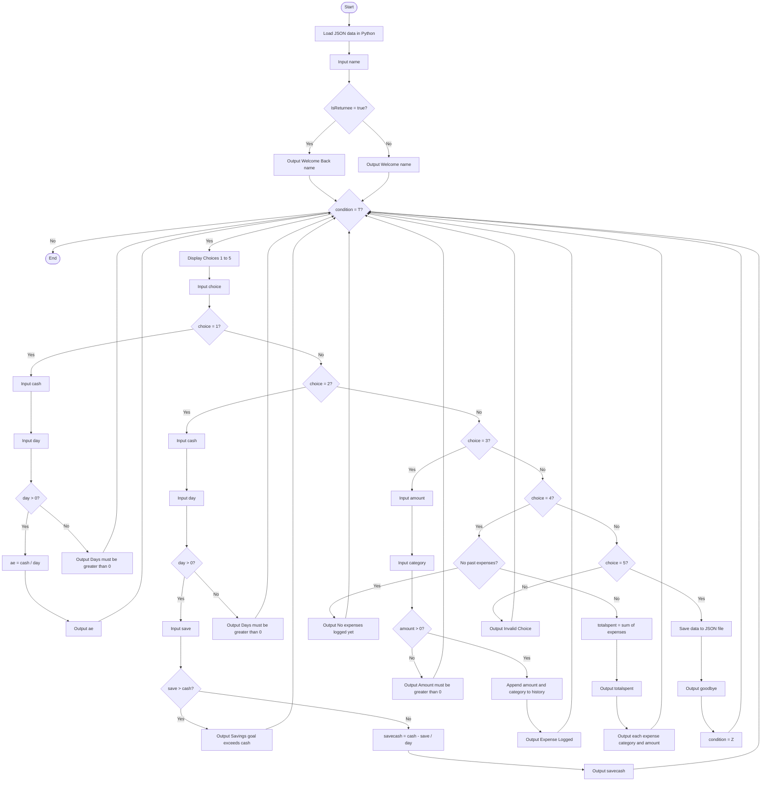

# Student Expense Tracker

## Problem Statement
We aim to address the issue of reckless spending among students. Many students spend their allowances impulsively on non-essential items (such as Labubus) without careful financial planning or budgeting.

## Project Objectives
* **Objective 1:** Analyze and summarize financial data from a chosen JSON dataset.
* **Objective 2:** Help users gain meaningful insights into their spending habits (e.g., averages, trends, and patterns).
* **Objective 3:** Practice JSON data handling and core Python programming concepts.

## Features
* **Feature 1:** Calculate the recommended daily expense limit for the week.
* **Feature 2:** Provide a daily expense recommendation adjusted for a specific savings goal.
* **Feature 3:** Welcoming a returnee user.
* **Feature 4:** Logging a new expense and categorizing it
* **Feature 5:** Summary/Save Calculator

## Planned Inputs and Outputs

### Inputs
* User's name
* Total available cash/allowance
* Current expenses and target savings amount

### Outputs
* Recommended daily spending limit for the week
* Adjusted daily spending limit while saving for a specific item or goal

## Logic Plan


## Pseudocode


```text
Load JSON data (initialize empty structure if file does not exist)

input name
normalized_name = lowercase(name)

if normalized_name exists in JSON data:
  load user profile and past expenses
  print "Welcome back, " + name
else:
  create new profile for name
  print "Welcome, " + name

loop:
  Display Choices
    [1] Calculations for average expense for the whole week
    [2] Calculations for daily recommended expense for saving
    [3] Log a new expense
    [4] View spending summary
    [5] Save and Exit

  input choice

  if choice == 1:
    input cash
    input day
    if day > 0:
      a_e = cash / day
      print a_e
    else:
      print "Days must be greater than 0."

  elif choice == 2:
    input cash
    input day
    if day > 0:
      input save
      if save > cash:
        print "Savings goal cannot be greater than available cash."
      else:
        savecash = (cash - save) / day
        print savecash
    else:
      print "Days must be greater than 0."

  elif choice == 3:
    input amount
    input category
    if amount > 0:
      append (amount, category) to user's past expenses
      print "Expense logged."
    else:
      print "Amount must be greater than 0."

  elif choice == 4:
    if user's past expenses is empty:
      print "No expenses logged yet."
    else:
      total_spent = sum of amount in user's past expenses
      print "Total spent: " + total_spent
      for each expense in user's past expenses:
        print expense.category + ": " + expense.amount

  elif choice == 5:
    save JSON data to file
    print "Goodbye!"
    break

  else:
    print "Invalid choice."
```

## Flowchart (HEADS-UP THIS WILL NOT WORK ON FLOWGORITHIM AS THIS IS MERELY A MEANS TO SHOW THE LOGIC)
flowchart TD


   
## GitHub Repository Link
[Project Repository](https://github.com/ktdiamante2031-tech/Project_Template_ComputerScience2)

